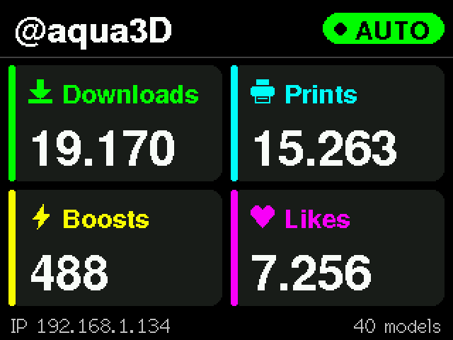
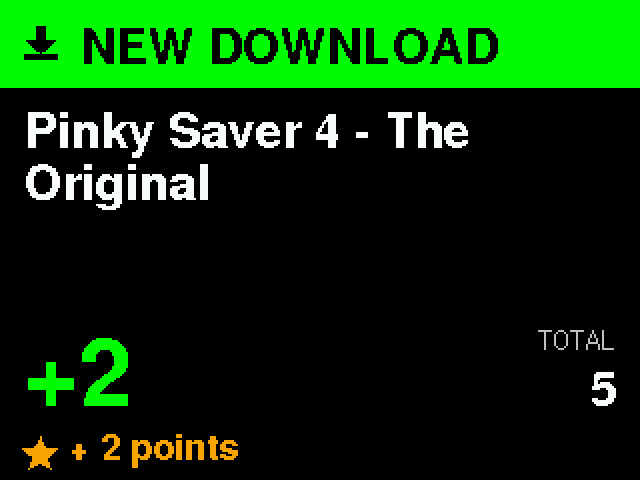

# 🚀 MakerWorld Live Monitor v2

Your MakerWorld stats live on a small ESP32 "Cheap Yellow Display", with Telegram and Home Assistant notifications.
**No browser extension and no PC needed**: the display reads MakerWorld by itself.


<p align="center">
  
  
</p>

## ✨ What's new in v2

- **Standalone mode**: the CYD reads your public MakerWorld profile on its own. The browser extension is no longer needed.
- **Exact totals**: Downloads, Prints, Boosts and Likes are the same numbers shown on your MakerWorld profile (the site rounds them, e.g. 19.2k; the display shows the exact value, e.g. 19.170).
- **New high-contrast interface**: bold fonts, big numbers, one color per stat, readable from across the room.
- **Notification queue**: several events at once are shown one after the other, none is lost.
- **Model photo in the notification**: the cover of the downloaded, printed or boosted model appears next to its name.
- **Telegram** straight from the display, with the model cover photo.
- **Home Assistant (MQTT)**: sensors appear automatically, plus an event entity for your automations.
- **CYD 2.4" support** (ESP32-2432S024), besides the classic 2.8" (ESP32-2432S028R).
- **Halo case**: a new 3D printable stand for both boards, [free on MakerWorld](https://makerworld.com/en/models/3577289-makerworld-live-monitor-v2).

## 🛠️ Hardware

- **ESP32-2432S028R** (CYD 2.8") or **ESP32-2432S024** (CYD 2.4"), about $10-15 on AliExpress
- USB-C cable and a 5 V USB power supply
- Optional: passive buzzer on GPIO 22 and GND for sound alerts (can be turned off in `/config`)

## 📦 Installation

### 🌐 Web Flasher (easiest)

1. Open the web flasher with **Chrome or Edge** on a computer: `flasher/index.html` (published on GitHub Pages at `https://aquascape123.github.io/makerworld-live-monitor-v2/flasher/`)
2. Connect the CYD with USB-C
3. Click the button for your board:
   - **Install MakerWorld Monitor** → CYD 2.8"
   - **Install for CYD 2.4"** → CYD 2.4"
   - **Install Color Fix** → only if your 2.8" shows wrong/inverted colors
4. Wait about 2 minutes, the CYD restarts by itself

### 💻 Arduino IDE

<details>
<summary>Build it yourself</summary>

1. Install the **esp32** boards (Espressif) in the Boards Manager and select **ESP32 Dev Module**
2. Install the libraries: **TFT_eSPI**, **ArduinoJson** (v7), **WiFiManager**, **PubSubClient**, **PNGdec**
3. Configure TFT_eSPI for the CYD (ILI9341, HSPI: MISO 12, MOSI 13, SCLK 14, CS 15, DC 2, backlight 21) with `TFT_INVERSION_ON`
4. For the **2.4"** board add `#define CYD_24` at the top of `makerworld_monitor_cyd.ino` (backlight on GPIO 27, screen rotated 180°)
5. Open `arduino/makerworld_monitor_cyd.ino` and upload

</details>

## 🔧 Setup

### 1️⃣ WiFi
After flashing, the CYD creates the WiFi network **`MakerWorld-Setup`**. Connect with your phone, choose your home WiFi and enter the password. The CYD restarts and shows its **IP address** at the bottom of the screen.

### 2️⃣ Your MakerWorld profile
Open `http://<CYD IP>/config` in a browser on the same network:

- **MakerWorld username**: e.g. `@aquascape` (or paste your profile link)
- **Check every**: 10-240 minutes (default 15)
- **Sound**: turn the buzzer on or off (startup and notification beeps)
- Press **Save**: the first check only saves the starting values, notifications start from the next change

Useful buttons on the same page: **Check now**, **Play test sound**, **Send Telegram test**, **Simulate 3 notifications**.

> ℹ️ **Points** are not shown in standalone mode: MakerWorld shows them only to the logged-in owner, and the display never stores your MakerWorld password. The fourth tile shows your **Likes** instead.

### 3️⃣ Telegram (optional)
1. Create a bot with [@BotFather](https://t.me/BotFather) (`/newbot`) and copy the **token**
2. Get your **chat ID** from [@userinfobot](https://t.me/userinfobot)
3. Send `/start` to your new bot
4. Paste token and chat ID in `http://<CYD IP>/config` and press **Send Telegram test**

### 4️⃣ Home Assistant (optional)
Open `http://<CYD IP>/mqtt`, enable it and enter your MQTT broker (e.g. the Mosquitto add-on), port `1883` and user/password.
With MQTT discovery these entities appear by themselves under the device **MakerWorld Monitor**:

| Entity | Description |
|---|---|
| Downloads, Prints, Boosts | profile totals |
| Likes | total likes (standalone mode) |
| Activity | event entity: `download`, `print`, `boost` with model name and amount |

Topics: `makerworld/<id>/state` (JSON, retained), `makerworld/<id>/event`, `makerworld/<id>/status` (`online`/`offline`).

<details>
<summary>Example automation: flash a light on every new print</summary>

```yaml
automation:
  - alias: MakerWorld new print
    trigger:
      - platform: state
        entity_id: event.makerworld_monitor_activity
    condition:
      - condition: template
        value_template: "{{ trigger.to_state.attributes.event_type == 'print' }}"
    action:
      - service: light.turn_on
        target: { entity_id: light.desk }
        data: { flash: short }
```
The entity id depends on your device name: check it in *Settings → Devices → MakerWorld Monitor*.
</details>

## 🖨️ Halo case

A desk case tilted by 15°, with a two-tone ring around the screen, slots under the chin and a snap-in back with buzzer grille.
**Download the 3D files on MakerWorld:** [MakerWorld Live Monitor v2](https://makerworld.com/en/models/3577289-makerworld-live-monitor-v2)

- 2 parts: front shell and snap-in back, no screws
- Versions for CYD 2.4" and CYD 2.8"
- Tested in PLA on the CYD 2.4"

## 🔌 HTTP endpoints

| Endpoint | Method | Description |
|---|---|---|
| `/config` | GET/POST | Setup page (profile, interval, sound, Telegram) |
| `/mqtt` | GET/POST | Home Assistant / MQTT settings |
| `/check-now` | POST | Check MakerWorld now |
| `/simulate` | POST | Show 3 test notifications with real models |
| `/test-sound` | POST | Play the notification sound |
| `/test-telegram` | POST | Send a Telegram test message |
| `/stats` | GET | Current totals (JSON) |
| `/screenshot` | GET | Screenshot of the display (BMP) |
| `/ping` | GET | Connection test |
| `/reset` | GET | Reset the stats |
| `/reset-wifi` | GET | Forget the WiFi and restart in setup mode |

The `/notify` and `/sync` endpoints of v1 are still there, so the old browser extension keeps working if you disable standalone mode.

## 🐛 Troubleshooting

- **Screen black, LED on** → you have a CYD 2.4": flash the *CYD 2.4"* firmware
- **Wrong colors** → flash the *Color Fix* firmware
- **Footer says "open /config to start"** → set your MakerWorld username in `http://<CYD IP>/config`
- **Footer shows "HTTP -1"** → no internet connection: the CYD reconnects and, after 3 failures in a row, restarts by itself
- **No Telegram messages** → send `/start` to your bot and use *Send Telegram test*
- **Home Assistant shows nothing** → check the status line at the bottom of `/mqtt` (e.g. "wrong user/password") and that MQTT discovery is enabled

## 🙏 Credits

Created with ❤️ by [@aquascape](https://makerworld.com/en/@aquascape) · 3D model on [MakerWorld](https://makerworld.com/en/models/3577289-makerworld-live-monitor-v2)

- Home Assistant support inspired by the pull request of [annaglyph](https://github.com/annaglyph) on v1
- Libraries: [TFT_eSPI](https://github.com/Bodmer/TFT_eSPI), [ArduinoJson](https://arduinojson.org/), [WiFiManager](https://github.com/tzapu/WiFiManager), [PubSubClient](https://github.com/knolleary/pubsubclient)
- v1 (with the browser extension): [makerworld-live-monitor](https://github.com/aquascape123/makerworld-live-monitor)

## 💖 Support

- ⭐ Star this repository
- 🐛 Report bugs in [Issues](https://github.com/aquascape123/makerworld-live-monitor-v2/issues)
- 🖨️ Print and boost my models on [MakerWorld](https://makerworld.com/en/@aquascape)
- ⚡️ Bitcoin Lightning: sullencicada855@walletofsatoshi.com

## 📝 License

MIT, see [LICENSE.md](LICENSE.md).
